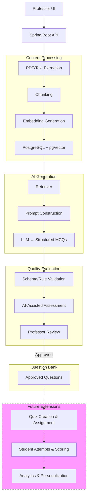

Project Title: AI-Based Personalised Quiz Generation and Evaluation System 

Synopsis for Mini Project (KCA 353)

Master of Computer Applications

Submitted by
Member 1 Roll No: [To be filled]
Member 2 Roll No: [To be filled]
Member 3 Roll No: [To be filled]

Under the guidance of
Supervisor: [To be filled]
Co-Supervisor: [To be filled]

Department of Computer Science and Engineering
Institute of Engineering and Technology, Lucknow
Dr. APJ Abdul Kalam Technical University, Uttar Pradesh
2026-27

Title
	AI-Based Personalised Quiz Generation and Evaluation System

## 1. Introduction

Preparing high-quality quizzes and assessments manually is a time-consuming and resource-intensive task for educators. With the increasing availability of digital learning materials, there is a growing need for automated systems that can generate relevant, pedagogically sound multiple-choice questions (MCQs) from course content. Existing rule-based and template-based methods often lack flexibility and contextual awareness, while modern Large Language Models (LLMs) face challenges such as factual hallucinations, poor distractor quality, and difficulty in aligning generated questions with specific cognitive levels.

In particular, automatically generated MCQs frequently suffer from unsupported answers, ambiguous wording, weak distractors, and unverified difficulty estimates.

These issues make it difficult for educators to adopt automated generation without extensive review and revision.

The proposed project addresses these issues by combining Retrieval-Augmented Generation (RAG) with LLMs to produce source-grounded MCQs, supported by automated quality evaluation and a human-in-the-loop review workflow. The system is designed as a professor-facing web application built with Java and Spring Boot. Professors upload PDF or text material, which the system processes into embeddings stored in PostgreSQL with pgVector. The RAG pipeline retrieves relevant passages, and an LLM generates structured MCQs. Deterministic validation checks structural correctness, while an LLM-as-a-Judge rubric provides quality scores. Professors review, edit, and approve questions into a question bank. The current semester MVP focuses on document processing, MCQ generation, structural validation, AI-based quality scoring, and professor-controlled question-bank management.

Quiz creation, student assignment, student attempts, automatic student scoring, and performance analytics are reserved for future work.

The primary objectives of this project are:
1. To extract and process uploaded PDF or text course material using Java-compatible document-processing libraries.
2. To generate embeddings and retrieve relevant source passages using PostgreSQL and pgVector.
3. To generate structured MCQs with question stem, four options, correct answer, explanation, and topic/difficulty fields using an LLM.
4. To perform deterministic structural validation ensuring exactly four distinct options, exactly one designated correct answer, and non-empty required fields.
5. To apply rubric-based AI scoring using an LLM-as-a-Judge approach covering correctness, relevance, clarity, answerability, distractor plausibility, and difficulty appropriateness.
6. To provide a professor-facing interface for viewing generated MCQs, inspecting AI evaluation results, and managing the approved question bank.

## 2. Related Works

### 2.1 Evolution of Automatic Question Generation

Automatic Question Generation (AQG) has evolved from rule-based and template-based methods to data-driven and Large Language Model (LLM)-based approaches. Kurdi et al. (2020) reviewed 93 papers published between 2015 and early 2019, identifying preprocessing, question construction, and post-processing as key stages in AQG. Anwar et al. (2026) extended this perspective by classifying modern methodologies into fine-tuning, prompting, pipeline-based, multi-agent, and hybrid approaches. Their survey also highlights Retrieval-Augmented Generation (RAG) as a technique for grounding generated questions in external knowledge.

### 2.2 Evaluation of Generated Questions

Evaluating question quality remains a major challenge. Moon et al. (2022) introduced Knowledge Dependent Answerability (KDA), a reference-free metric designed to assess whether a question targets the intended knowledge. Gorgun and Bulut (2024) highlighted the limitations of conventional metrics such as BLEU and ROUGE, which measure textual similarity but do not adequately capture pedagogical quality. They also noted the cost and inconsistency associated with human evaluation.

Paixão et al. (2025) combined prompt engineering techniques, including role-based prompting, glossary use, one-shot prompting, and self-review, with an LLM-as-a-Judge approach to evaluate MCQs for format, language, grammar, relevance, and option correctness. These approaches demonstrate the value of structured evaluation, while leaving challenges around reliable assessment of factual correctness and educational usefulness.

### 2.3 RAG-Based Generation and Real-World Applications

Recent studies have explored LLM-based question generation in educational settings. Pradeesh et al. (2025) integrated RAG with the Ample Learning Management System (LMS) to generate MCQs from PDF documents, targeting contextual relevance and reduced manual effort. Badenes-Olmedo and Eyzaguirre (2026) developed QuerIA, which uses contextual learning, semantic chunking, and Bloom-aligned prompting. Its deployment involved 341 participants across 17 faculties, who generated nearly 6,000 questions during one academic semester. These studies demonstrate the practical potential of contextualized question generation, while also highlighting the need for systematic quality assessment.

### 2.4 Psychometric Quality and Research Gap

Crk and Gultepe (2026) compared expert-validated LLM-generated MCQs with human-authored items using psychometric measures, including item difficulty, discrimination, and reliability. They found no statistically significant differences across the reported comparisons, but also identified limitations in item discrimination and reliability. Their findings reinforce the importance of expert validation and caution against assuming that generated questions are automatically equivalent to human-authored assessments.

Overall, the literature identifies three key challenges: grounding questions and answers in reliable source material, evaluating MCQ quality beyond textual similarity, and maintaining human oversight. Existing approaches address parts of these challenges, but factual support, distractor plausibility, answerability, and cognitive-level alignment still require careful assessment.

### 2.5 Relevance to the Proposed System

The proposed system addresses these challenges by combining RAG with LLM-based MCQ generation in a Java and Spring Boot architecture, using PostgreSQL with pgVector for semantic retrieval. Deterministic validation checks structural requirements, while an LLM-as-a-Judge rubric estimates question quality across defined criteria. Professors can inspect source passages, review evaluation results, edit questions, and approve them into a curated question bank.

Unlike a system that relies on generation alone, this approach combines source traceability, automated checks, quality assessment, and professor review. The scores are treated as estimates rather than proof of correctness or educational effectiveness, and the system's performance will be examined through functional testing and a planned preliminary evaluation.

## 3. Existing / Proposed Methodology

The proposed system follows a modular architecture built on a Spring Boot backend with PostgreSQL for relational data and pgVector for embedding storage and similarity search. The end-to-end RAG pipeline processes uploaded PDF or text material through the following stages:

1. Document Ingestion and Text Extraction: The professor uploads a PDF or text file through the web interface. PDFs are parsed using Apache PDFBox, and the extracted text is cleaned, normalized, and split into manageable chunks using a character-based splitter with overlapping segments to preserve context across chunk boundaries.

2. Embedding and Vector Storage: Each text chunk is converted into a vector embedding using a pre-trained embedding model accessible via Java-compatible SDK or HTTP API. The resulting embeddings, together with their source chunk metadata, are stored in a pgVector-backed vector store for efficient semantic retrieval.

3. Retrieval-Augmented Generation: When a professor requests MCQs on a specific topic, the system retrieves the most relevant document chunks from the vector store via cosine similarity. A prompt is then constructed that includes the retrieved source passages, the desired topic, and the intended Bloom's taxonomy cognitive level. The system also prompts the LLM to indicate, for each generated question, which source chunk(s) supported the question stem, the correct answer, and the explanation.

4. Structured MCQ Generation: An LLM (e.g., LLaMA 3-8B or GPT-4, to be finalized during implementation) generates the question stem, four options, the designated correct answer, an explanation, the associated topic, and a model-estimated difficulty level in a structured JSON format. Each generated item also records identifiers for the source chunk(s) that supported its content, enabling traceability back to the original document.

5. Schema Validation: A deterministic, programmatic validator checks the output structure of each generated MCQ. It enforces required-field presence, exactly four distinct options, exactly one designated correct answer, and non-empty required fields. It also performs exact duplicate detection by comparing the normalized question stem and options against previously approved items in the question bank. These checks validate the structure and basic integrity of the MCQ; they do not assess factual correctness, pedagogical soundness, or semantic uniqueness.

6. Automated Quality Evaluation: An LLM-as-a-Judge quality assessor evaluates each structurally valid MCQ using a predefined rubric covering correctness and support from retrieved source material, relevance to the requested topic, clarity and unambiguous wording, answerability from the available context, plausibility of distractors, and appropriateness of the estimated difficulty. Criterion-level scores and concise explanations are returned. The scoring scale and thresholds are to be finalized during implementation. This evaluation is an approximate semantic quality estimate, not a validated measurement of educational effectiveness.

7. Professor Review and Approval: Generated questions, their associated source passages, AI evaluation scores, and explanations are presented to the professor in the review interface. The professor can inspect the supporting evidence, edit the question or options, reject the item, or approve it. Approved questions, together with their source traceability metadata, evaluation records, and generation parameters, are stored in a curated question bank. Rejected or edited items are retained with revision history where appropriate to support traceability and future refinement.

The schematic below illustrates the proposed RAG-based MCQ generation and evaluation workflow:

### Pending Design Decisions

The following design decisions remain open and will be finalized during a later implementation and planning phase:

- LLM provider and model selection
- Embedding model selection and hosting approach
- LLM-as-a-Judge scoring scale and thresholds
- Chunk size and overlap parameters for text splitting

## 4. Evaluation Methodology

The evaluation plan combines programmatic functional tests, automated quality assessment, and a planned preliminary human review. Formal research evaluation of scoring reliability and student learning outcomes remains outside the current MVP.

### 4.1 Measurable Criteria

The system will be evaluated against the following criteria:

1. **Structural validity:** percentage of generated MCQs satisfying schema rules.
2. **Factual correctness and source support:** proportion of questions whose correct answer and explanation are supported by retrieved source passages.
3. **Relevance:** alignment with the requested topic.
4. **Clarity:** absence of ambiguous wording or grammatical errors.
5. **Answerability:** whether the question can be answered from the available context.
6. **Distractor quality:** plausibility of incorrect options relative to the source material.
7. **Bloom-level alignment:** match between the requested Bloom's taxonomy level and the generated question's cognitive demand, assessed by reviewer judgment against a structured rubric. Exact agreement thresholds are undecided.
8. **Estimated difficulty alignment:** consistency between the requested difficulty level and the model-estimated difficulty label, assessed using a predefined rubric or categorical agreement. This is an estimate only and does not reflect empirical difficulty derived from student-response data.
9. **Duplicate rate:** percentage of generated questions that are exact duplicates of items already in the question bank.

### 4.2 Evaluation Methods and Limitations

Each criterion is assessed as follows:

- **Programmatic checks:** Structural validity and exact duplicate detection are implemented as deterministic validators returning pass/fail or exact-match results. They cannot assess semantic quality, factual correctness, or pedagogical soundness.
- **LLM-as-a-Judge assessment:** An LLM evaluates correctness/source support, relevance, clarity, answerability, distractor quality, Bloom-level alignment, and difficulty alignment using a predefined rubric, returning criterion-level scores and explanations. This is an approximate semantic quality estimate. Limitations include potential bias, inconsistency, and absence of validated ground truth. The scoring scale and thresholds are pending design decisions.
- **Professor review:** The professor inspects generated questions, supporting evidence, and AI scores, then approves or rejects items. This provides final human judgment but is not a formal inter-rater reliability study.

### 4.3 Judge Limitations

AI-generated scores are estimates only. They may be biased by prompt wording, model training data, or stochastic generation. They do not prove factual correctness, pedagogical effectiveness, or alignment with course objectives. The system supports, but does not replace, professor judgment.

### 4.4 Planned Human Review

A preliminary subject-matter review by two reviewers is proposed as a planned evaluation activity, not an implemented MVP feature. The review would assess a sample of generated MCQs against the criteria above and record inter-rater agreement where feasible. If two-reviewer assessment is infeasible due to time or resource constraints, the limitation will be documented, and evaluation will rely on single-reviewer professor judgment together with functional tests.

### 4.5 Feasible Preliminary Experiment

A preliminary evaluation of 30–50 generated MCQs is proposed, subject to available time and resources. The sampling procedure would select MCQs from a representative set of uploaded source documents across different topics and Bloom's levels. Each item would be reviewed using the criteria and methods described above. This experiment has not been conducted; the plan describes what would be evaluated if resources permit.

### 4.6 Baseline Comparison

The evaluation includes a baseline comparison between MCQ generation with retrieved context (RAG) and generation without retrieved context, keeping the model, prompts, source material, and other settings as consistent as possible. Comparison criteria include the measurable criteria listed in Section 4.1, with particular attention to factual correctness, source support, and distractor plausibility. This comparison is intended as a hypothesis test, not a conclusive proof of superiority.

### 4.7 Evidence-Based Claims

Results will be reported as observations from the evaluated sample rather than established general conclusions. Any apparent improvement in source support or question quality will be treated as preliminary evidence, with broader claims requiring further evaluation.

### 4.8 Psychometric Limits

The project does not claim psychometric equivalence between LLM-generated and human-authored MCQs, nor validated student learning outcomes. Such claims require student-response data, Item Response Theory analysis, and formal reliability studies, all of which are outside the current MVP.

## 5. Expected Results

The expected outcomes of the proposed system include:

- A working professor-facing web application for MCQ generation from uploaded course material.
- Traceable links between each generated question and the retrieved source passages used for its generation.
- Deterministic schema validation and rubric-based quality assessment for all generated MCQs.
- A professor-controlled approval workflow for editing, rejecting, or archiving generated questions.
- A curated question bank that supports review and reuse of approved items.
- An evaluation report documenting functional test results, observed output quality, common failure cases, and system limitations.

Acceptance checks for the MVP are defined as functional tests for each objective:

1. PDF/text extraction: Uploaded documents are processed into extractable, normalized text chunks.

2. Embedding and retrieval: Relevant source passages are retrieved for a given topic query.

3. MCQ generation: The system produces structured MCQs with the required fields in valid JSON.

4. Structural validation: Generated MCQs pass schema checks, including exactly four distinct options, exactly one designated correct answer, and non-empty required fields.

5. AI rubric scoring: Each generated MCQ receives criterion-level scores and explanations for the six rubric dimensions.

6. Professor interface: Generated MCQs and AI scores are displayed, and approved questions are stored in the question bank.

Functional testing covers these acceptance checks and does not constitute a formal research study of scoring reliability or student learning outcomes.

In addition to functional testing, a planned preliminary evaluation experiment is described in Sections 4.5 and 4.6, including the baseline comparison methodology and evidence-based reporting approach.

### 5.1 Limitations and Assumptions

The following limitations and assumptions apply to the current MVP:

1. **Retrieval errors:** The system depends on retrieving relevant source passages. Retrieved passages may be incomplete, irrelevant, or insufficient to support a generated question, which can affect factual correctness and source support.
2. **LLM evaluation bias:** LLM-as-a-Judge scores are estimates only. They may be inconsistent, biased by prompt wording or model training data, and do not independently establish factual correctness or pedagogical effectiveness.
3. **Source quality dependence:** The quality, completeness, and accuracy of generated questions depend partly on the quality, coverage, and organization of the uploaded source material.
4. **No empirical personalization:** The current professor-facing MVP does not use student performance data or response histories to personalize quizzes. Personalization remains future scope.
5. **Human review necessity:** Professor or subject-matter review remains necessary before approved questions are used in assessments. The system supports but does not replace human judgment.
6. **Difficulty estimation limits:** Model-estimated difficulty is an approximate label and is not equivalent to empirical difficulty measured from student-response data.
7. **Experimental limitations:** Results from a small preliminary sample of 30–50 MCQs may not generalize to other subjects, documents, models, or student populations.

## 6. Future Scope

The following features and research extensions are outside the current MVP and are planned for subsequent phases:

- Quiz creation and assignment to classes or individual students.
- Student quiz attempts, automatic scoring, and performance tracking.
- Topic-level performance analytics, identification of weak and strong topics, and personalized practice recommendations.
- Adaptive question selection based on student performance.
- Formal research evaluation of AI scoring reliability, including comparison with professor ratings and inter-rater reliability analysis.
- Advanced psychometric evaluation and Item Response Theory.
- Fine-tuning an open-source LLM on domain-specific educational content.

## 7. Plan of work

| Phase   | Description                                                                                                                                                 |
| ------- | ----------------------------------------------------------------------------------------------------------------------------------------------------------- |
| Phase 1 | Requirement finalization, ERD design, and technology stack setup.                                                                                           |
| Phase 2 | PDF/text extraction, chunking, embedding, and pgVector integration.                                                                                         |
| Phase 3 | RAG retrieval pipeline, prompt engineering, and structured MCQ generation.                                                                                  |
| Phase 4 | Schema validation, AI-assisted quality evaluation, and professor review UI.                                                                                 |
| Phase 5 | Question bank management and professor workflow testing.                                                                                                    |
| Phase 6 | Functional testing, planned preliminary evaluation experiment including baseline comparison, analysis of evaluation findings, bug fixes, and documentation. |
| Phase 7 | Final integration, deployment, and report preparation.                                                                                                      |

## 8. Conclusion

The proposed AI-Based Personalised Quiz Generation and Evaluation System aims to assist educators by automating the creation of source-grounded MCQs through a RAG-enhanced LLM pipeline. By combining automated generation with deterministic validation, rubric-based quality assessment, and professor review, the system addresses key challenges in factual correctness, clarity, and distractor quality.

The modular Spring Boot architecture is designed for implementation and evaluation within a three-member team, with future extensions planned for quiz delivery, student assessment, and personalized practice. This project contributes a practical methodology for generating traceable, reviewable assessment items while maintaining academic rigor through structured evaluation and human oversight.

References

[1] G. Kurdi, J. Leo, B. Parsia, U. Sattler, and S. Al-Emari, "A systematic review of automatic question generation for educational purposes," Int. J. Artif. Intell. Educ., vol. 30, pp. 121–204, 2020, doi: 10.1007/s40593-019-00186-y, doi: [https://doi.org/10.1007/s40593-019-00186-y](https://doi.org/10.1007/s40593-019-00186-y).

[2] H. Moon et al., "Evaluating the Knowledge Dependency of Questions," in Proceedings of EMNLP 2022, pp. 10512–10526, doi: 10.18653/v1/2022.emnlp-main.718, doi: [https://doi.org/10.18653/v1/2022.emnlp-main.718](https://doi.org/10.18653/v1/2022.emnlp-main.718).

[3] G. Gorgun and O. Bulut, "Current Evaluation Methods are a Bottleneck in Automatic Question Generation," in Proceedings of the AAAI Conference on Artificial Intelligence, Vancouver, BC, Canada, 2024, pp. 3–8, [https://proceedings.mlr.press/v257/gorgun24a.html](https://proceedings.mlr.press/v257/gorgun24a.html).

[4] N. Pradeesh, T. Remya, M. G. Thushara, K. A. Krishna, and V. Pranav, "Retrieval-Augmented Generation for Multiple-Choice Questions and Answers Generation," Procedia Computer Science, vol. 259, pp. 504–511, 2025, doi: 10.1016/j.procs.2025.03.352, doi: [https://doi.org/10.1016/j.procs.2025.03.352](https://doi.org/10.1016/j.procs.2025.03.352).

[5] S. S. Mucciaccia, T. M. Paixão, F. Mutz, A. F. De Souza, C. S. Badue, and T. Oliveira-Santos, "Automatic Multiple-Choice Question Generation and Evaluation Systems Based on LLM: A Study Case With University Resolutions," in Proceedings of COLING 2025, pp. 2246–2260, 2025, [https://aclanthology.org/2025.coling-main.154/](https://aclanthology.org/2025.coling-main.154/).

[6] C. Badenes-Olmedo and P. Eyzaguirre, "QuerIA: adaptive question generation and evaluation in higher education using large language models and contextual learning," Expert Syst. Appl., vol. 301, no. C, p. 130140, Mar. 2026, doi: 10.1016/j.eswa.2025.130140, doi: [https://doi.org/10.1016/j.eswa.2025.130140](https://doi.org/10.1016/j.eswa.2025.130140).

[7] M. R. Anwar, S. Khalid, S. Alshahrani, H. S. M. Bilal, and M. Aldawsari, "MCQs Generation With Large Language Models: A Survey of Methodologies, Evolution, and Open Research Issues," IEEE Access, vol. 14, pp. 10991–11018, 2026, doi: 10.1109/ACCESS.2026.3652006, doi: [https://doi.org/10.1109/ACCESS.2026.3652006](https://doi.org/10.1109/ACCESS.2026.3652006).

[8] I. Crk and E. Gultepe, "Evaluating the instrumental quality of LLM-generated assessment items," Front. Educ., vol. 11, p. 1837523, Jun. 2026, doi: 10.3389/feduc.2026.1837523, doi: [https://doi.org/10.3389/feduc.2026.1837523](https://doi.org/10.3389/feduc.2026.1837523).
