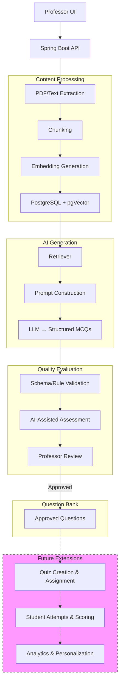

Project Title: AI-Based Personalized Quiz Generation and Evaluation System Using Retrieval-Augmented Generation and Large Language Models

Synopsis for Mini Project (KCA 353)

Master of Computer Applications

Submitted by
Member 1 Roll No: [To be filled]
Member 2 Roll No: [To be filled]
Member 3 Roll No: [To be filled]

Under the guidance of
Supervisor: [To be filled]
Co-Supervisor: [To be filled]

Department of Computer Science and Engineering
Institute of Engineering and Technology, Lucknow
Dr. APJ Abdul Kalam Technical University, Uttar Pradesh
2026-27

Title
	AI-Based Personalized Quiz Generation and Evaluation System Using Retrieval-Augmented Generation and Large Language Models

## 1. Introduction

Preparing high-quality quizzes and assessments manually is a time-consuming and resource-intensive task for educators. With the increasing availability of digital learning materials, there is a growing need for automated systems that can generate relevant, pedagogically sound multiple-choice questions (MCQs) from course content. Existing rule-based and template-based methods often lack flexibility and contextual awareness, while modern Large Language Models (LLMs) face challenges such as factual hallucinations, poor distractor quality, and difficulty in aligning generated questions with specific cognitive levels.

In particular, automatically generated MCQs frequently suffer from unsupported answers, ambiguous wording, weak distractors, and unverified difficulty estimates.

These issues make it difficult for educators to adopt automated generation without extensive review and revision.

The proposed project addresses these issues by combining Retrieval-Augmented Generation (RAG) with LLMs to produce source-grounded MCQs, supported by automated quality evaluation and a human-in-the-loop review workflow. The system is designed as a professor-facing web application built with Java and Spring Boot. Professors upload PDF or text material, which the system processes into embeddings stored in PostgreSQL with pgVector. The RAG pipeline retrieves relevant passages, and an LLM generates structured MCQs. Deterministic validation checks structural correctness, while an LLM-as-a-Judge rubric provides quality scores. Professors review, edit, and approve questions into a question bank. The current semester MVP focuses on document processing, MCQ generation, structural validation, AI-based quality scoring, and professor-controlled question-bank management. Quiz creation, student assignment, student attempts, automatic student scoring, and performance analytics are reserved for future work.

The primary objectives of this project are:
1. To extract and process uploaded PDF or text course material using Java-compatible document-processing libraries.
2. To generate embeddings and retrieve relevant source passages using PostgreSQL and pgVector.
3. To generate structured MCQs with question stem, four options, correct answer, explanation, and topic/difficulty fields using an LLM.
4. To perform deterministic structural validation ensuring exactly four distinct options, exactly one designated correct answer, and non-empty required fields.
5. To apply rubric-based AI scoring using an LLM-as-a-Judge approach covering correctness, relevance, clarity, answerability, distractor plausibility, and difficulty appropriateness.
6. To provide a professor-facing interface for viewing generated MCQs, inspecting AI evaluation results, and managing the approved question bank.

## 2. Related works

Automatic Question Generation (AQG) has evolved from rule-based and template-driven systems toward data-driven and LLM-based approaches. Kurdi et al. (2020) systematically reviewed 93 papers published between 2015 and early 2019 and identified a generic workflow organized around preprocessing, question construction, and post-processing. Their findings highlighted persistent gaps in controlled difficulty generation, enrichment of question forms, and harmonized evaluation metrics. Later surveys, such as Anwar et al. (2026), formalized this workflow into three core phases—content identification and selection, item construction, and quality assurance and refinement—while classifying modern LLM-based methodologies into fine-tuning, prompting, pipeline/modular, multi-agent, and hybrid approaches, with RAG emerging as a key technique for grounding generation in external knowledge.

On the evaluation side, Moon et al. (2022) proposed Knowledge Dependent Answerability (KDA), a reference-free metric that measures whether a question correctly targets the intended knowledge fact. KDA addresses the limitation of n-gram similarity metrics, which disregard educational value and depend on gold-standard references. Gorgun and Bulut (2024) further emphasized that current evaluation methods remain a bottleneck because of the absence of standardized, cost-effective quality criteria; human evaluation is expensive and inconsistent, crowdsourcing raises reliability concerns, and automatic metrics like BLEU and ROUGE do not capture pedagogical soundness.

Recent generation studies demonstrate both progress and remaining challenges. Badenes-Olmedo and Eyzaguirre (2026) deployed QuerIA, a locally hosted LLM-based system with Bloom-aligned prompting and semantic chunking, at Universidad Politécnica de Madrid, where 341 participants from 17 faculties generated nearly 6,000 questions in one semester. User feedback confirmed the clarity and educational usefulness of the generated items, showing that locally deployable systems can operate at scale. Pradeesh N et al. (2025) integrated RAG with the Ample LMS to automate MCQ generation from PDFs, demonstrating that retrieved source passages improve contextual relevance and reduce the manual workload for educators. Paixão et al. (2025) combined prompt engineering techniques—including role-based prompting, glossary use, one-shot prompting, and self-review—with an LLM-as-a-Judge evaluation system using GPT-4o to assess MCQ validity across format, language, grammar, relevance, and option correctness.

Empirical psychometric studies report mixed but informative findings. Crk and Gultepe (2026) examined zero-shot, expert-validated LLM-authored MCQs against human-written items and found no statistically significant differences in Item Difficulty, Discrimination Index, Corrected Point-Biserial Correlation, Item Reliability Index, or network-based psychometric comparisons. However, the study also noted that both human and LLM-authored items exhibited low discrimination and moderate reliability, and that expert validation was essential to accept generated questions. These results suggest that LLM-generated MCQs can be fair and well-composed under expert review, but do not establish universal equivalence or eliminate the need for quality assessment.

Taken together, the literature reveals several unresolved challenges that our project addresses. First, source grounding remains inconsistent: LLMs can produce plausible but unsupported answers, and distractors often reflect surface-level associations rather than genuine misconceptions. Second, MCQ quality evaluation lacks standardized, automatic criteria that correlate with educational usefulness; existing metrics either require expensive human review or measure textual similarity rather than pedagogical value. Third, distractor plausibility and answerability depend on the retrieved context and require validation against the specific source material. Fourth, professor oversight is necessary to ensure factual correctness and alignment with course objectives, but manual review is time-consuming without systematic support.

Our proposed system responds to these gaps by combining RAG with LLMs within a Java and Spring Boot architecture. PostgreSQL with pgVector stores embeddings of uploaded course material, enabling semantic retrieval of relevant passages for each generated question. Deterministic structural validation enforces the basic requirements of exactly four distinct options and exactly one correct answer. An LLM-as-a-Judge rubric provides criterion-level scores for correctness, relevance, clarity, answerability, distractor plausibility, and difficulty appropriateness, returning concise explanations that support professor review. Approved questions enter a curated question bank, and functional testing covers document extraction, retrieval, generation, validation, scoring, and the professor interface. This design preserves source traceability, keeps the professor in the loop, and avoids promising guaranteed correctness or validated scoring reliability.

## 3. Existing / Proposed Methodology

The proposed system follows a modular architecture built on a Spring Boot backend with PostgreSQL for relational data and pgVector for embedding storage and similarity search. The RAG pipeline processes uploaded PDF or text material through the following stages:

1. Document Ingestion and Text Extraction: PDFs are parsed using Apache PDFBox and text is cleaned and normalized. Content is split into manageable chunks using a character-based splitter with overlapping segments to preserve context.

2. Embedding and Vector Storage: Text chunks are embedded using a pre-trained embedding model accessible via Java-compatible SDK or HTTP API and stored in a pgVector-backed vector store for efficient semantic retrieval.

3. Retrieval-Augmented Generation: When a professor requests MCQs on a topic, the system retrieves the most relevant document chunks via cosine similarity and constructs a prompt that includes the source context, desired difficulty level, and Bloom's taxonomy alignment.

4. Structured MCQ Generation: An LLM (e.g., LLaMA 3-8B or GPT-4, to be finalized during implementation) generates the question stem, four options, correct answer, explanation, topic, and difficulty estimate in a structured JSON format.

5. Schema Validation: A deterministic validator checks the output structure, ensuring exactly four distinct options, exactly one designated correct answer, and non-empty required fields. These checks validate MCQ structure, not student responses.

6. Automated Quality Evaluation: An LLM-as-a-Judge quality assessor scores the MCQ on correctness and support from retrieved source material, relevance to the requested topic, clarity and unambiguous wording, answerability from the available context, plausibility of distractors, and appropriateness of estimated difficulty. Criterion-level scores and concise explanations are returned. The scoring scale and thresholds are to be finalized during implementation.

7. Professor Review and Approval: Generated questions and their AI scores are presented to the professor, who can edit, reject, or approve them. Approved questions enter the question bank.

The schematic below illustrates the proposed RAG-based MCQ generation and evaluation workflow:

## 4. Expected Results

The expected outcomes of the proposed system include:

- A working professor-facing web application for MCQ generation from uploaded course material.
- Traceable links between each generated question and the retrieved source passages used for its generation.
- Deterministic schema validation and rubric-based quality assessment for all generated MCQs.
- A professor-controlled approval workflow for editing, rejecting, or archiving generated questions.
- A curated question bank that supports review and reuse of approved items.
- An evaluation report documenting functional test results, observed output quality, common failure cases, and system limitations.

Acceptance checks for the MVP are defined as functional tests for each objective:

1. PDF/text extraction: Uploaded documents are processed into extractable, normalized text chunks.

2. Embedding and retrieval: Relevant source passages are retrieved for a given topic query.

3. MCQ generation: The system produces structured MCQs with the required fields in valid JSON.

4. Structural validation: Generated MCQs pass schema checks, including exactly four distinct options, exactly one designated correct answer, and non-empty required fields.

5. AI rubric scoring: Each generated MCQ receives criterion-level scores and explanations for the six rubric dimensions.

6. Professor interface: Generated MCQs and AI scores are displayed, and approved questions are stored in the question bank.

Functional testing covers these acceptance checks and does not constitute a formal research study of scoring reliability or student learning outcomes.

## 5. Future Scope

The following features and research extensions are outside the current MVP and are planned for subsequent phases:

- Quiz creation and assignment to classes or individual students.
- Student quiz attempts, automatic scoring, and performance tracking.
- Topic-level performance analytics, identification of weak and strong topics, and personalized practice recommendations.
- Adaptive question selection based on student performance.
- Formal research evaluation of AI scoring reliability, including comparison with professor ratings and inter-rater reliability analysis.
- Advanced psychometric evaluation and Item Response Theory.
- Fine-tuning an open-source LLM on domain-specific educational content.

## 6. Plan of work

| Phase   | Description                                                                                                                                     |
| ------- | ----------------------------------------------------------------------------------------------------------------------------------------------- |
| Phase 1 | Requirement finalization, ERD design, and technology stack setup.                                                                               |
| Phase 2 | PDF/text extraction, chunking, embedding, and pgVector integration.                                                                             |
| Phase 3 | RAG retrieval pipeline, prompt engineering, and structured MCQ generation.                                                                      |
| Phase 4 | Schema validation, AI-assisted quality evaluation, and professor review UI.                                                                     |
| Phase 5 | Question bank management and professor workflow testing.                                                                                        |
| Phase 6 | Functional testing, review of sample generated MCQs and their outputs to identify quality issues and limitations, bug fixes, and documentation. |
| Phase 7 | Final integration, deployment, and report preparation.                                                                                          |

7. Conclusion

The proposed AI-Based Personalized Quiz Generation and Evaluation System aims to assist educators by automating the creation of source-grounded MCQs through a RAG-enhanced LLM pipeline. By combining automated generation with deterministic validation, rubric-based quality assessment, and professor review, the system addresses key challenges in factual correctness, clarity, and distractor quality.

The modular Spring Boot architecture is designed for implementation and evaluation within a three-member team, with future extensions planned for quiz delivery, student assessment, and personalized practice. This project contributes a practical methodology for generating traceable, reviewable assessment items while maintaining academic rigor through structured evaluation and human oversight.

References

[1] G. Kurdi, J. Leo, B. Parsia, U. Sattler, and S. Al-Emari, "A systematic review of automatic question generation for educational purposes," International Journal of Artificial Intelligence in Education, vol. 30, pp. 121–204, 2020, doi: 10.1007/s40593-019-00186-y.

[2] H. Moon et al., "Evaluating the Knowledge Dependency of Questions," in Proceedings of EMNLP 2022, pp. 10512–10526, doi: 10.18653/v1/2022.emnlp-main.718.

[3] G. Gorgun and O. Bulut, "Current Evaluation Methods are a Bottleneck in Automatic Question Generation," in Proceedings of the AI for Education Workshop at AAAI 2024, 2024.

[4] N. Pradeesh et al., "Retrieval-Augmented Generation for Multiple-Choice Questions and Answers Generation," Procedia Computer Science, vol. 259, pp. 504–511, 2025, doi: 10.1016/j.procs.2025.03.352.

[5] T. M. Paixão et al., "Automatic Multiple-Choice Question Generation and Evaluation Systems Based on LLM: A Study Case With University Resolutions," in Proceedings of COLING 2025, pp. 2246–2260, 2025, doi: 10.18653/v1/2025.coling-main.154.

[6] C. Badenes-Olmedo and P. Eyzaguirre, "QuerIA: adaptive question generation and evaluation in higher education using large language models and contextual learning," Expert Systems with Applications, vol. 301, p. 130140, 2026, doi: 10.1016/j.eswa.2025.130140.

[7] M. R. Anwar et al., "MCQs Generation With Large Language Models: A Survey of Methodologies, Evolution, and Open Research Issues," in IEEE Access, vol. 14, 2026, doi: 10.1109/ACCESS.2026.3652006.

[8] I. Crk and E. Gultepe, "Evaluating the instrumental quality of LLM-generated assessment items," Frontiers in Education, vol. 11, p. 1837523, 2026, doi: 10.3389/feduc.2026.1837523.
