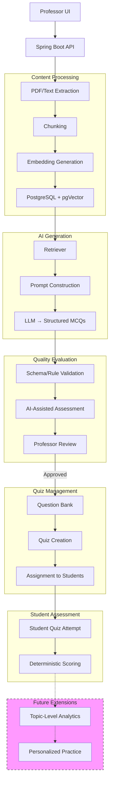

Project Title: AI-Based Personalized Quiz Generation and Evaluation System Using Retrieval-Augmented Generation and Large Language Models

Synopsis for Mini Project (KCA 353)

Master of Computer Applications

Submitted by
Member 1 Roll No: [To be filled]
Member 2 Roll No: [To be filled]
Member 3 Roll No: [To be filled]

Under the guidance of
Supervisor: [To be filled]
Co-Supervisor: [To be filled]

Department of Computer Science and Engineering
Institute of Engineering and Technology, Lucknow
Dr. APJ Abdul Kalam Technical University, Uttar Pradesh
2026-27

Title
	AI-Based Personalized Quiz Generation and Evaluation System Using Retrieval-Augmented Generation and Large Language Models

1. Introduction

Preparing high-quality quizzes and assessments manually is a time-consuming and resource-intensive task for educators. With the increasing availability of digital learning materials, there is a growing need for automated systems that can generate relevant, pedagogically sound multiple-choice questions (MCQs) from course content. Existing rule-based and template-based methods often lack flexibility and contextual awareness, while modern Large Language Models (LLMs) face challenges such as factual hallucinations, poor distractor quality, and difficulty in aligning generated questions with specific cognitive levels. In particular, automatically generated MCQs frequently suffer from unsupported answers, ambiguous wording, weak distractors, and unverified difficulty estimates. These issues make it difficult for educators to adopt automated generation without extensive review and revision.

The proposed project addresses these issues by combining Retrieval-Augmented Generation (RAG) with LLMs to produce source-grounded MCQs, supported by automated quality evaluation and a human-in-the-loop review workflow. The system is designed as a professor-facing web application that accepts PDF or text material, generates MCQs through a RAG pipeline, validates them using deterministic and AI-assisted checks, and maintains an approved question bank for quiz assignment and student assessment. The current semester MVP focuses on professor-facing functionality: document upload, MCQ generation, quality evaluation, professor review and approval, question-bank management, quiz creation, assignment to students, and deterministic scoring. Topic-level performance analytics, personalized practice recommendations, adaptive difficulty, and advanced psychometric evaluation are reserved for future work.

The primary objectives of this project are:
1. To process uploaded PDF or text course material through text extraction, chunking, and embedding generation.
2. To retrieve relevant source passages from the embedded document store using semantic similarity search.
3. To generate structured MCQs with question stem, four options, correct answer, explanation, topic, and difficulty estimate using an LLM.
4. To perform deterministic validation of generated MCQs, ensuring structural correctness and exactly one correct answer.
5. To evaluate MCQ quality using a rubric-based AI assessment covering correctness, relevance, clarity, answerability, distractor plausibility, and difficulty appropriateness.
6. To provide a professor review interface for editing, approving, or rejecting generated questions.
7. To manage an approved question bank and support quiz creation and assignment to classes or individual students.
8. To conduct a feasibility study evaluating the quality of generated MCQs against the defined rubric, documenting failure cases and system limitations.

2. Related works

Automatic Question Generation (AQG) has evolved significantly over the past three decades. Kurdi et al. (2020) provided a systematic review of 93 papers published between 2015 and early 2019, identifying a three-phase generic AQG pipeline: Content Identification and Selection, Item Construction, and Quality Assurance and Refinement. Their findings highlighted persistent gaps in controlled difficulty generation, enrichment of question forms, and harmonized evaluation metrics. Moon et al. (2022) later proposed Knowledge Dependent Answerability (KDA), a reference-free metric that measures whether a question correctly targets the intended knowledge fact, addressing the lack of assessment-value-oriented evaluation. Gorgun and Bulut (2024) emphasized that current evaluation methods remain a bottleneck due to the absence of standardized, cost-effective quality criteria. On the generation side, Badenes-Olmedo and Eyzaguirre (2025) demonstrated that locally deployable LLM-based systems with Bloom-aligned prompting can achieve pedagogical validity at scale. Pradeesh N et al. (2025) showed that RAG integration with LMS platforms can automate contextually relevant MCQ generation from PDFs. Paixão et al. (2025) proposed prompt engineering and automatic evaluation systems for university-resolution MCQs. Recent surveys (Anwar et al., 2026) classify modern methodologies into fine-tuning, prompting, pipeline/modular, multi-agent, and hybrid approaches, with RAG emerging as a key technique for grounding generation in external knowledge. Empirical evaluations such as Crk and Gultepe (2026) further show that carefully validated LLM-authored MCQs can be psychometrically indistinguishable from human-written items.

3. Existing / Proposed Methodology

The proposed system follows a modular architecture built on a Spring Boot backend with PostgreSQL for relational data and pgVector for embedding storage and similarity search. The RAG pipeline processes uploaded PDF or text material through the following stages:

1. Document Ingestion and Text Extraction: PDFs are parsed using document loaders (e.g., PyPDFLoader) and split into manageable chunks using a character-based splitter with overlapping segments to preserve context.
2. Embedding and Vector Storage: Text chunks are embedded using a pre-trained sentence-transformer model and stored in a pgVector-backed vector store for efficient semantic retrieval.
3. Retrieval-Augmented Generation: When a professor requests MCQs on a topic, the system retrieves the most relevant document chunks via cosine similarity and constructs a prompt that includes the source context, desired difficulty level, and Bloom's taxonomy alignment.
4. Structured MCQ Generation: An LLM (e.g., LLaMA 3-8B or GPT-4) generates the question stem, four options, correct answer, explanation, topic, and difficulty estimate in a structured JSON format.
5. Schema Validation: A deterministic validator checks the output structure, ensuring exactly one correct answer, four distinct options, and non-empty fields.
6. Automated Quality Evaluation: An AI-assisted quality assessor scores the MCQ on correctness, relevance, clarity, answerability, distractor plausibility, and difficulty appropriateness using LLM-as-a-Judge and reference-free metrics.
7. Professor Review and Approval: Generated questions are presented to the professor, who can edit, reject, or approve them. Approved questions enter the question bank.
8. Quiz and Assignment Management: Professors create quizzes from the approved question bank and assign them to classes or selected students.
9. Student Attempt and Deterministic Scoring: Students attempt quizzes with single-attempt locking; scoring is deterministic and testable, separating practice scores from official assessment scores.

The schematic below illustrates the proposed RAG-based MCQ generation and evaluation workflow:

4. Expected Results

The expected outcomes of the proposed system include:
- A working professor-facing web application for MCQ generation from uploaded course material.
- Traceable links between each generated question and the retrieved source passages used for its generation.
- Deterministic schema validation and rubric-based quality assessment for all generated MCQs.
- A professor-controlled approval workflow for editing, rejecting, or archiving generated questions.
- A curated question bank that supports quiz assembly and student assignment.
- An evaluation report documenting quality ratings, common failure modes, and system limitations.
- A documented baseline comparison of generation quality across selected prompt strategies or model configurations, if included in the evaluation plan.

5. Plan of work

Phase 1 (Weeks 1-2): Requirement finalization, ERD design, and technology stack setup.
Phase 2 (Weeks 3-4): PDF/text extraction, chunking, embedding, and pgVector integration.
Phase 3 (Weeks 5-6): RAG retrieval pipeline, prompt engineering, and structured MCQ generation.
Phase 4 (Weeks 7-8): Schema validation, AI-assisted quality evaluation, and professor review UI.
Phase 5 (Weeks 9-10): Question bank, quiz creation, assignment, and deterministic scoring.
Phase 6 (Weeks 11-12): Testing, small-scale evaluation, bug fixes, and documentation.
Phase 7 (Weeks 13-14): Final integration, deployment, and report preparation.

6. Conclusion

The proposed AI-Based Personalized Quiz Generation and Evaluation System aims to assist educators by automating the creation of source-grounded MCQs through a RAG-enhanced LLM pipeline. By combining automated generation with deterministic validation, rubric-based quality assessment, and professor review, the system addresses key challenges in factual correctness, clarity, and distractor quality. The modular architecture is designed for implementation and evaluation within a three-member team, with future extensions planned for topic-level analytics and personalized practice. This project contributes a practical methodology for generating traceable, reviewable assessment items while maintaining academic rigor through structured evaluation and human oversight.

References

[1] G. Kurdi, J. Leo, B. Parsia, U. Sattler, and S. Al-Emari, "A systematic review of automatic question generation for educational purposes," International Journal of Artificial Intelligence in Education, vol. 30, pp. 121–204, 2020, doi: 10.1007/s40593-019-00186-y.

[2] H. Moon et al., "Evaluating the Knowledge Dependency of Questions," in Proceedings of EMNLP 2022, pp. 10512–10526, doi: 10.18653/v1/2022.emnlp-main.718.

[3] G. Gorgun and O. Bulut, "Current Evaluation Methods are a Bottleneck in Automatic Question Generation," in Proceedings of the AI for Education Workshop at AAAI 2024, 2024.

[4] C. Badenes-Olmedo and P. Eyzaguirre, "QuerIA: adaptive question generation and evaluation in higher education using large language models and contextual learning," Expert Systems with Applications, vol. 301, p. 130140, 2025, doi: 10.1016/j.eswa.2025.130140.

[5] N. Pradeesh et al., "Retrieval-Augmented Generation for Multiple-Choice Questions and Answers Generation," Procedia Computer Science, vol. 259, pp. 504–511, 2025, doi: 10.1016/j.procs.2025.03.352.

[6] T. M. Paixão et al., "Automatic Multiple-Choice Question Generation and Evaluation Systems Based on LLM: A Study Case With University Resolutions," in Proceedings of COLING 2025, 2025, doi: 10.18653/v1/2025.coling-main.154.

[7] M. R. Anwar et al., "MCQs Generation With Large Language Models: A Survey of Methodologies, Evolution, and Open Research Issues," in IEEE Access, vol. 14, 2026, doi: 10.1109/ACCESS.2026.3652006.

[8] I. Crk and E. Gultepe, "Evaluating the instrumental quality of LLM-generated assessment items," Frontiers in Education, vol. 11, p. 1837523, 2026, doi: 10.3389/feduc.2026.1837523.
