# AI-Based Personalized Quiz Generation and Evaluation System

## Project Overview Document

**Document Type:** Project Overview  
**Version:** 1.0  
**Project Stage:** Brainstorming and Scope Definition  
**Primary Users:** Professors and Students

---

## 1. Project Overview

The **AI-Based Personalized Quiz Generation and Evaluation System** is an educational web application designed to help professors create quizzes efficiently and help students improve their academic performance through personalized practice.

The system uses Artificial Intelligence (AI) to generate questions from a selected topic or study material, evaluates student responses, analyzes performance, and recommends suitable practice quizzes based on individual learning needs.

The system has two primary user roles:

- **Professor:** Generates, reviews, publishes, and assigns quizzes to students. Professors can also analyze individual and class-level performance.
    
- **Student:** Attempts assigned quizzes, views marks and feedback, identifies strong and weak topics, and generates personalized practice quizzes to improve performance.
    

The central idea is to connect quiz generation, evaluation, and personalization into a continuous learning cycle.

### 1.1 Problem Statement

Traditional quiz preparation and evaluation can require significant manual effort from professors. Students may receive a score after an assessment but lack detailed information about their topic-wise weaknesses and what they should practice next.

The proposed system addresses these problems by:

1. Automating quiz generation using AI.
    
2. Supporting structured quiz assignment and evaluation.
    
3. Providing topic-wise performance analytics.
    
4. Generating personalized practice quizzes based on previous performance.
    
5. Helping professors identify common learning gaps across their classes.
    

### 1.2 Project Objectives

- Reduce the effort required to prepare quizzes.
    
- Provide a structured platform for conducting academic quizzes.
    
- Evaluate objective questions automatically.
    
- Identify students' strong and weak topics.
    
- Adapt practice quizzes to students' performance.
    
- Help professors understand class-level learning gaps.
    
- Track student progress over multiple quiz attempts.
    

---

## 2. Project Scope

The system should focus on AI-powered quiz generation, evaluation, and personalized learning. Class management and user management exist to support these core capabilities.

### 2.1 In Scope

|Module|Main capabilities|
|---|---|
|Authentication|Registration, login, role-based access|
|Class Management|Create classes, generate join codes, enroll students|
|AI Quiz Generation|Generate questions from topics or study material|
|Quiz Management|Review, edit, publish, and assign quizzes|
|Quiz Attempt|Display questions, record answers, submit attempts|
|Evaluation|Calculate scores and provide feedback|
|Performance Analytics|Topic-wise accuracy, strengths, weaknesses, progress|
|Personalization|Recommend topics and generate targeted practice quizzes|
|Quiz History|View previous attempts and results|

### 2.2 Optional Enhancements

The following features should be considered only after the core workflow is functional:

- PDF or notes upload for quiz generation.
    
- Timed examination mode.
    
- Revision quizzes based on previously incorrect answers.
    
- AI-assisted short-answer evaluation.
    
- PDF export of quiz results.
    
- Advanced revision scheduling.
    

### 2.3 Out of Scope for the Initial Version

- Attendance management.
    
- Live classes or video conferencing.
    
- Social networking and messaging.
    
- Webcam-based proctoring.
    
- A complete learning management system.
    
- Training a custom large language model from scratch.
    

These exclusions keep the project manageable for a three-member team.

---

## 3. User Roles and Responsibilities

### 3.1 Professor

The professor manages the assessment workflow.

**Responsibilities:**

1. Register and log in as a professor.
    
2. Create a class and share its join code.
    
3. Generate quizzes using AI.
    
4. Specify the topic, difficulty, question count, and question types.
    
5. Review generated questions and correct any issues before publication.
    
6. Assign a quiz to a class and configure its deadline.
    
7. View student submissions and scores.
    
8. Analyze individual and class-level performance.
    
9. Identify topics that require additional teaching or revision.
    

**Example:** A professor creates a quiz on recursion containing 15 questions. The professor reviews the generated questions and publishes the quiz to a class. After students submit their attempts, the system displays scores and highlights topics where students commonly struggle.

### 3.2 Student

The student uses the system for assessment and continuous practice.

**Responsibilities:**

1. Register and log in as a student.
    
2. Join a class using a valid join code.
    
3. View assigned quizzes and deadlines.
    
4. Attempt quizzes and submit answers.
    
5. View scores, correct answers, and explanations when permitted.
    
6. View personal performance analytics.
    
7. Identify strong and weak topics.
    
8. Generate personalized practice quizzes.
    
9. Track improvement over time.
    

**Example:** A student scores 45% on a professor's recursion quiz. The system identifies recursion as a weak topic and recommends foundational practice. The student generates a practice quiz, reviews mistakes, and attempts another quiz to assess improvement.

---

## 4. High-Level System Architecture

The system follows a modular architecture with a frontend, backend, database, and external AI provider.

```mermaid
flowchart TB
    P["Professor"]
    S["Student"]

    subgraph Frontend["Frontend Application"]
        PF["Professor Dashboard"]
        SF["Student Dashboard"]
        QI["Quiz Interface"]
        PA["Performance Analytics UI"]
    end

    subgraph Backend["Backend Application"]
        AUTH["Authentication and Authorization"]
        CM["Class Management"]
        QM["Quiz Management"]
        QG["AI Quiz Generation Service"]
        EV["Evaluation Service"]
        AN["Performance Analytics Service"]
        PE["Personalization Engine"]
    end

    DB[("Relational Database")]
    AI["External AI Model API"]

    P --> PF
    S --> SF

    PF --> AUTH
    SF --> AUTH
    PF --> CM
    PF --> QM
    SF --> QI
    SF --> PA

    QM --> QG
    QG --> AI
    QG --> QM

    QI --> EV
    EV --> DB
    QM --> DB
    CM --> DB
    AUTH --> DB

    DB --> AN
    AN --> PE
    PE --> QG
    AN --> PA
    EV --> PA
```



### 4.1 Architecture Explanation

**Frontend Application**

Provides the user interface for professors and students. It handles forms, quiz attempts, dashboards, and the presentation of results.

**Backend Application**

Contains the application's business logic. It handles permissions, quiz lifecycle management, evaluation, analytics, and personalization.

**Relational Database**

Stores users, classes, enrollments, quizzes, questions, attempts, responses, and performance information.

**External AI Model API**

Generates educational questions and explanations from structured instructions and, if supported, supplied study material.

The AI provider is an external dependency. The backend should communicate with it rather than exposing API credentials to the frontend.

**Important architectural decision:** The evaluation service and personalization engine should remain separate from the AI generation service. Objective scoring must be deterministic, while personalization should use stored performance data and explicit rules.

---

## 5. Major System Components

### 5.1 Authentication and Authorization Module

**Purpose:** Ensure users can access only the functionality and data permitted by their roles.

**Responsibilities:**

- Register and authenticate users.
    
- Assign the Professor or Student role.
    
- Protect backend endpoints.
    
- Enforce class ownership and enrollment permissions.
    
- Restrict professors to classes and results they are authorized to access.
    
- Prevent students from accessing other students' private performance data.
    

**Example:** A student must not be able to publish a professor's quiz by directly calling a backend endpoint. Hiding a button in the frontend is not security; the backend must enforce the permission.

### 5.2 Class Management Module

**Purpose:** Connect professors with the students who should receive their quizzes.

**Responsibilities:**

- Create and update classes.
    
- Generate unique class join codes.
    
- Allow students to join classes.
    
- Maintain enrollment records.
    
- Associate quizzes with the appropriate class.
    

**Example:** A professor creates a class called Data Structures and shares its join code with enrolled students.

**Scope boundary:** This module does not need attendance, timetables, or full course management.

### 5.3 AI Quiz Generation Module

**Purpose:** Generate structured educational questions based on professor or student requirements.

**Inputs:**

- Topic or subject.
    
- Difficulty level.
    
- Number of questions.
    
- Question types.
    
- Optional study material.
    

**Outputs:**

- Question statement.
    
- Answer options, where applicable.
    
- Correct answer or reference answer.
    
- Explanation.
    
- Topic tag.
    
- Difficulty label.
    

**Responsibilities:**

1. Validate the requested generation parameters.
    
2. Construct a prompt for the AI provider.
    
3. Request structured question data.
    
4. Parse and validate the response.
    
5. Detect duplicate or incomplete questions where possible.
    
6. Reject or regenerate invalid output within a limited retry policy.
    
7. Store accepted questions.
    

**Important limitation:** Valid JSON does not guarantee a correct question or answer key. AI-generated content can still be factually wrong or ambiguous. Professors should be able to review and edit assessment questions before publishing them.

For student practice quizzes, the system should apply the same quality checks before displaying the generated questions.

### 5.4 Quiz Management Module

**Purpose:** Manage the lifecycle of a quiz from creation to completion.

**Responsibilities:**

- Create quizzes.
    
- Associate quizzes with their creators.
    
- Store question configuration and question data.
    
- Allow professors to review and edit drafts.
    
- Publish and assign quizzes.
    
- Configure deadlines and availability.
    
- Track quiz status.
    
- Distinguish assigned assessments from student-generated practice quizzes.
    

A quiz can have different origins:

- **Professor-created assessment:** Intended for a class and subject to assignment rules.
    
- **Student-generated practice quiz:** Intended for the student's personal learning and not automatically included in official class marks.
    

This distinction is essential. Practice scores must not silently become official assessment results.

### 5.5 Quiz Attempt Module

**Purpose:** Provide a controlled environment for students to answer questions.

**Responsibilities:**

- Display published questions.
    
- Record selected answers.
    
- Support submission.
    
- Enforce quiz availability and deadlines.
    
- Prevent unauthorized attempts.
    
- Handle duplicate submission requests safely.
    
- Store attempt status and submission time.
    

**Example:** A student opens an assigned quiz, answers its questions, and submits the attempt before the deadline.

The backend should validate the quiz assignment, attempt permissions, and submission state instead of trusting the browser.

### 5.6 Evaluation Module

**Purpose:** Evaluate student responses and calculate results.

**For objective questions:**

- Compare submitted answers with stored answer keys.
    
- Calculate marks according to the quiz's scoring rules.
    
- Calculate total score and percentage.
    
- Store per-question results.
    
- Provide explanations and corrections according to quiz release settings.
    

**For short-answer questions, if added later:**

- Compare the response with a reference answer and grading rubric.
    
- Use AI-assisted evaluation with clearly defined criteria.
    
- Support partial credit where appropriate.
    
- Make clear that AI grading may be imperfect.
    

For the initial version, MCQs and true/false questions are sufficient. Deterministic evaluation is easier to verify and more reliable than using an LLM to grade every answer.

**Security requirement:** Correct answers must remain server-side and must not be returned to the student before the permitted reveal time.

### 5.7 Performance Analytics Module

**Purpose:** Convert quiz attempts into meaningful information about student learning.

**Student analytics:**

- Total quizzes attempted.
    
- Average score and recent performance.
    
- Accuracy by topic.
    
- Strong and weak topics.
    
- Performance by difficulty.
    
- Progress across attempts.
    

**Professor analytics:**

- Class average.
    
- Score distribution.
    
- Submission status.
    
- Individual student performance.
    
- Topic-wise class accuracy.
    
- Commonly misunderstood concepts.
    

**Example:** The professor sees that a large proportion of students struggled with recursion, while a student sees that recursion is one of their own weakest topics.

These dashboards should share the underlying assessment data but apply different access permissions and aggregation rules.

### 5.8 Personalization Engine

**Purpose:** Select suitable topics and difficulty levels for subsequent practice quizzes.

The initial implementation should use a transparent rule-based approach rather than a trained recommendation model.

**Inputs:**

- Topic-wise accuracy.
    
- Number of attempts.
    
- Recent performance.
    
- Previous incorrect answers.
    
- Difficulty of attempted questions.
    

**Outputs:**

- Recommended practice topics.
    
- Suggested difficulty.
    
- Topic distribution for the next quiz.
    
- Optional revision recommendations.
    

**Example rules:**

- Low accuracy across sufficient attempts: prioritize foundational practice.
    
- Moderate accuracy: continue with targeted practice.
    
- Consistently high accuracy: introduce harder questions.
    
- Repeated mistakes: include new questions testing the same underlying concepts.
    

The exact thresholds should be configurable and tested. They are initial heuristics, not universal measures of mastery.

The engine should also handle insufficient data. A new student should receive a baseline quiz or a user-selected difficulty rather than being classified as weak in every topic.

---

## 6. Primary User Workflows

### 6.1 Professor Workflow

```
flowchart TD
    A["Professor Login"] --> B["Create or Select Class"]
    B --> C["Configure Quiz"]
    C --> D["Generate Questions Using AI"]
    D --> E["Validate Generated Content"]
    E --> F{"Questions Acceptable?"}
    F -- "No" --> G["Edit or Regenerate Questions"]
    G --> E
    F -- "Yes" --> H["Publish and Assign Quiz"]
    H --> I["Students Attempt Quiz"]
    I --> J["System Evaluates Responses"]
    J --> K["Update Performance Analytics"]
    K --> L["Professor Reviews Class Results"]
```

**Workflow explanation:**

1. The professor authenticates.
    
2. The professor selects a class and configures a quiz.
    
3. The AI generation service creates questions.
    
4. The system validates the generated content.
    
5. The professor reviews and corrects questions.
    
6. The professor publishes the quiz and sets assignment rules.
    
7. Students attempt the quiz.
    
8. The evaluation service calculates results.
    
9. Analytics are updated.
    
10. The professor reviews individual and class-level performance.
    

### 6.2 Student Assessment and Practice Workflow

```
flowchart TD
    A["Student Login"] --> B["View Assigned Quizzes"]
    B --> C["Attempt Assigned Quiz"]
    C --> D["Submit Responses"]
    D --> E["Automated Evaluation"]
    E --> F["Display Results and Feedback"]
    F --> G["Update Topic-wise Performance"]
    G --> H["Identify Weak Topics"]
    H --> I["Generate Personalized Practice Quiz"]
    I --> J["Attempt Practice Quiz"]
    J --> K["Evaluate Practice Results"]
    K --> L["Update Learning Profile"]
    L --> M{"More Practice Needed?"}
    M -- "Yes" --> H
    M -- "No" --> N["Continue Learning"]
```

**Workflow explanation:**

1. The student views assigned quizzes.
    
2. The student attempts and submits an assessment.
    
3. The system evaluates the responses.
    
4. The student views permitted feedback and marks.
    
5. The system updates the student's topic-wise performance.
    
6. Weak topics are identified.
    
7. The student generates a practice quiz targeted at those topics.
    
8. The practice attempt is evaluated separately.
    
9. The student's learning profile is updated.
    
10. The student continues practicing or moves to other topics.
    

The key differentiator is the connection between assessment results and subsequent practice. Generating questions is only the first step.

---

## 7. Data Model Overview

The following diagram shows the main conceptual entities and their relationships. It is an initial domain model, not a finalized database schema.

```mermaid
erDiagram
    USER ||--o{ CLASS : teaches
    USER ||--o{ ENROLLMENT : joins
    CLASS ||--o{ ENROLLMENT : contains
    CLASS ||--o{ QUIZ : receives
    USER ||--o{ QUIZ : creates
    QUIZ ||--|{ QUESTION : contains
    USER ||--o{ QUIZ_ATTEMPT : makes
    QUIZ ||--o{ QUIZ_ATTEMPT : receives
    QUIZ_ATTEMPT ||--o{ RESPONSE : contains
    QUESTION ||--o{ RESPONSE : answered_in
    USER ||--o{ TOPIC_PERFORMANCE : has

    USER {
        long id PK
        string name
        string email
        string password_hash
        string role
    }

    CLASS {
        long id PK
        long professor_id FK
        string name
        string join_code
    }

    ENROLLMENT {
        long id PK
        long class_id FK
        long student_id FK
        datetime joined_at
    }

    QUIZ {
        long id PK
        long creator_id FK
        long class_id FK
        string title
        string origin
        string status
        datetime deadline
    }

    QUESTION {
        long id PK
        long quiz_id FK
        string question_text
        string question_type
        string topic
        string difficulty
        json answer_data
    }

    QUIZ_ATTEMPT {
        long id PK
        long quiz_id FK
        long student_id FK
        decimal score
        string status
        datetime submitted_at
    }

    RESPONSE {
        long id PK
        long attempt_id FK
        long question_id FK
        json submitted_answer
        boolean is_correct
        decimal awarded_marks
    }

    TOPIC_PERFORMANCE {
        long id PK
        long student_id FK
        string topic
        decimal accuracy
        int attempt_count
        datetime updated_at
    }
```

### 7.1 Entity Responsibilities

**USER**

Stores shared identity information and the user's role. Roles should be validated by the backend.

**CLASS**

Represents an academic class owned by a professor.

**ENROLLMENT**

Connects students to classes. A separate entity supports multiple students per class and multiple class enrollments per student.

**QUIZ**

Stores quiz metadata, creator, publication state, and assignment information. Student-generated practice quizzes can exist without a class assignment.

**QUESTION**

Stores generated or edited questions, their topic tags, difficulty, and answer data.

**QUIZ_ATTEMPT**

Represents one student's attempt at a quiz. Multiple attempts may be permitted for practice, while official assessments may have stricter rules.

**RESPONSE**

Stores the answer submitted for an individual question and its evaluation outcome.

**TOPIC_PERFORMANCE**

Stores or caches topic-wise performance for personalization and dashboards. It can be recalculated from attempt data when necessary.

### 7.2 Important Data Model Decisions

- Use foreign keys to preserve relationships.
    
- Enforce unique class enrollments.
    
- Keep quiz creator identity separate from student attempt identity.
    
- Distinguish official assessment attempts from practice attempts through quiz origin and assignment context.
    
- Define how edited questions affect existing attempts.
    
- Keep answer keys protected from student-facing API responses.
    
- Consider storing a question snapshot or version for each attempt so that editing a published quiz does not corrupt historical results.
    

The schema should be finalized during detailed design rather than copied directly from this conceptual diagram.

---

## 8. AI Generation and Validation Pipeline

AI-generated content needs validation before it becomes part of an assessment.

```
flowchart TD
    A["Generation Request"] --> B["Validate Request Parameters"]
    B --> C["Build AI Prompt"]
    C --> D["Call AI Provider"]
    D --> E["Parse Structured Response"]
    E --> F{"Schema Valid?"}
    F -- "No" --> G["Retry Within Limit or Reject"]
    G --> D
    F -- "Yes" --> H["Validate Question Fields"]
    H --> I["Check Duplicates and Answer Completeness"]
    I --> J["Check Source Grounding Where Applicable"]
    J --> K["Professor Review or Practice Approval"]
    K --> L["Store Accepted Quiz"]
```

### Validation Responsibilities

The validation pipeline should check:

1. Every question has the required fields.
    
2. The number and format of options are correct.
    
3. Correct-answer references point to valid options.
    
4. Questions are not exact duplicates within the same quiz.
    
5. Topic and difficulty metadata are present.
    
6. Source references are preserved when study material is used.
    
7. Invalid AI output is rejected or regenerated within a limited retry policy.
    

Automated checks cannot prove that every answer is factually correct. Human review, source-grounded generation, and a clear error-reporting mechanism remain important.

---

## 9. Suggested Technology Architecture

The technology stack can be selected based on the team's existing skills. A conventional web application is sufficient.

|Layer|Suggested technology|Purpose|
|---|---|---|
|Frontend|React|Professor and student interfaces|
|Backend|Spring Boot|APIs and business logic|
|Database|PostgreSQL|Persistent relational data|
|ORM|Spring Data JPA / Hibernate|Database access|
|Authentication|Spring Security|Authentication and authorization|
|AI Integration|External LLM API|Quiz and explanation generation|
|API Documentation|OpenAPI / Swagger|API exploration and testing|
|Deployment|One suitable cloud hosting platform|Application availability|

The application can initially be implemented as a **modular monolith** rather than separate microservices.

This means the backend is deployed as one application but divided internally into modules such as authentication, class management, quiz generation, evaluation, analytics, and personalization.

A modular monolith reduces deployment and communication overhead while allowing the team to maintain clear boundaries in the code.

---

## 10. Non-Functional Requirements

### Security

- Enforce role-based access control on the backend.
    
- Store password hashes, never plaintext passwords.
    
- Protect AI API credentials in server-side configuration.
    
- Restrict access to answer keys before permitted reveal times.
    
- Validate class ownership and enrollment.
    
- Prevent students from accessing other students' private records.
    

### Reliability

- Validate AI output before saving questions.
    
- Handle AI provider failures and rate limits.
    
- Limit retries and avoid infinite regeneration loops.
    
- Handle duplicate submissions safely.
    
- Preserve submitted answers and historical results.
    

### Performance

- Avoid unnecessary AI calls.
    
- Store accepted generated quizzes for reuse.
    
- Paginate quiz history and large result lists.
    
- Use efficient database queries for analytics.
    

### Usability

- Keep professor quiz creation straightforward.
    
- Make student results understandable.
    
- Explain why a topic is recommended for practice.
    
- Clearly distinguish official marks from practice scores.
    

### Maintainability

- Separate business logic into modules.
    
- Use DTOs and validation for API requests.
    
- Define consistent error responses.
    
- Write tests for scoring, authorization, and personalization rules.
    

---

## 11. Proposed Development Phases

### Phase 1: Foundation

- Define the data model and API contracts.
    
- Implement authentication and role-based access.
    
- Build class creation and enrollment.
    
- Set up the database and project structure.
    

### Phase 2: Quiz Generation and Management

- Integrate the AI provider.
    
- Generate structured questions.
    
- Implement question validation and editing.
    
- Add quiz publication and assignment.
    

### Phase 3: Quiz Attempt and Evaluation

- Implement the student quiz interface.
    
- Save submitted responses.
    
- Calculate objective scores.
    
- Store attempt history and release feedback.
    

### Phase 4: Analytics and Personalization

- Calculate topic-wise accuracy.
    
- Build professor and student dashboards.
    
- Identify weak topics.
    
- Generate personalized practice quizzes.
    
- Track performance changes across attempts.
    

### Phase 5: Testing and Finalization

- Test authentication and access permissions.
    
- Validate scoring against known answers.
    
- Review AI-generated question quality.
    
- Test personalization with synthetic learner histories.
    
- Test end-to-end professor and student workflows.
    
- Deploy and prepare the project demonstration.
    

---

## 12. Success Criteria

The project should be evaluated using measurable criteria rather than the number of features implemented.

|Area|Evaluation method|
|---|---|
|Quiz generation|Human-review a sample for clarity, relevance, duplication, and correctness|
|Evaluation|Compare automated objective scores with manually calculated scores|
|Personalization|Verify that weak-topic performance influences the next practice quiz|
|Analytics|Verify that displayed metrics match stored attempts|
|Security|Test unauthorized access to quizzes, answer keys, and results|
|Reliability|Test malformed AI output, provider failures, and duplicate submissions|
|Usability|Ask representative users to complete the main workflows and record issues|

For the final demonstration, use one complete scenario:

1. A professor creates a class.
    
2. Students join the class.
    
3. The professor generates and publishes a quiz.
    
4. Students attempt the quiz.
    
5. The system evaluates responses and displays results.
    
6. The professor views class-level weaknesses.
    
7. A student generates a personalized practice quiz.
    
8. The student completes another attempt and reviews progress.
    

This scenario demonstrates the connection between every major component.

---

## 13. Final Project Definition

The project is a two-role educational application centered on AI-powered quiz generation, automated evaluation, and personalized practice.

Professors use the system to create and assign assessments and analyze class performance. Students use it to complete assessments, understand their results, identify weak topics, and generate targeted practice quizzes.

The primary technical contribution is not simply calling an AI model to produce questions. It is the integration of generated educational content with reliable evaluation, topic-wise performance analysis, and a feedback loop that adapts future practice to the student's needs.

**Recommended initial scope:** Professor and Student roles, class enrollment, AI-generated MCQs and true/false questions, question review, quiz assignment, objective evaluation, topic-wise analytics, and rule-based personalized practice.

This scope provides sufficient technical depth for a three-member final-year team while remaining aligned with the original project title.